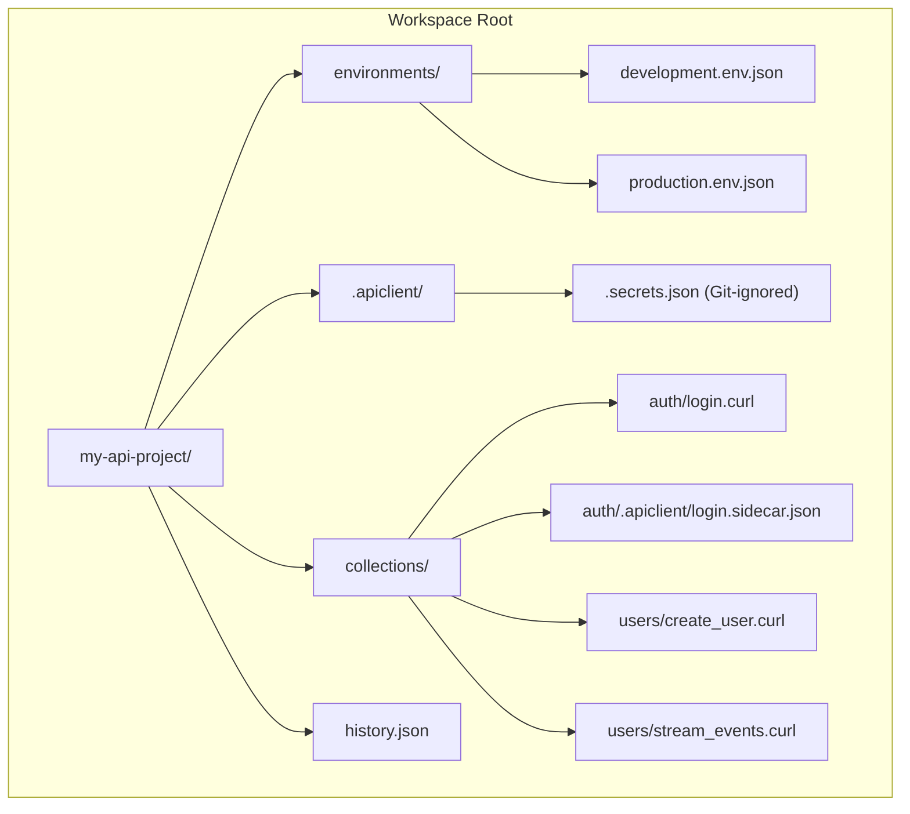

<p align="center">
  
</p>

<h1 align="center">API Client Reborn</h1>

<p align="center">
  <strong>The lightweight, native, Git-friendly API client &amp; cURL playground.</strong>
</p>

<p align="center">
  <a href="https://github.com/theankitgaurav/api-client-reborn/releases"></a>
  <a href="https://tauri.app/"></a>
  <a href="https://svelte.dev/"></a>
  <a href="https://www.rust-lang.org/"></a>
  <a href="https://www.typescriptlang.org/"></a>
  <a href="https://tailwindcss.com/"></a>
  
  
  <a href="LICENSE"></a>
</p>

<p align="center">
  <a href="#-why-api-client-reborn">Why API Client Reborn?</a> •
  <a href="#-features">Features</a> •
  <a href="#-comparison">Comparison</a> •
  <a href="#-architecture--file-formats">File Formats</a> •
  <a href="#-installation">Installation</a> •
  <a href="#-quickstart">Quickstart</a> •
  <a href="#-keyboard-shortcuts">Shortcuts</a> •
  <a href="#-license">License</a>
</p>

---

## ⚡ Why API Client Reborn?

Modern API clients have become bloated, sluggish, and increasingly captive behind forced cloud logins, mandatory workspaces, and paid subscription paywalls. Simple requests take seconds to launch, consume hundreds of megabytes of RAM, and store your collections in proprietary cloud databases.

**API Client Reborn** is built on a clean, modern philosophy:

- 🚀 **Blazing Native Performance**: Powered by **Tauri v2** and **Rust** with native OS webviews. Cold startup is virtually instantaneous (<150 ms) and idle memory footprint is just **~35 MB** (instead of 500+ MB on Electron).
- 💾 **100% Local & Git-Native**: Your API requests are saved as plain, human-readable `.curl` files directly on your filesystem. Version-control requests alongside your code with standard `git commit`, `git diff`, and pull requests.
- 🕘 **Persistent Request History**: Every sent request and its response are recorded in `history.json` under the workspace directory (by default `~/.api-client-reborn`) and can be searched in the sidebar.
- 🐚 **True CLI & cURL Interoperability**: Every request is a 100% valid, runnable command. Copy as cURL, run directly in your terminal, or export complete collections to zero-dependency standalone POSIX shell scripts (`.sh`).
- 🛡️ **Zero Cloud Lock-In & Zero Telemetry**: No mandatory accounts, no cloud sync, no tracking, and no paywalls. Everything executes on your own machine.
- 🌊 **Streaming & SSE Ready**: First-class support for chunked responses and Server-Sent Events with intelligent sliding-window memory defense and disk spooling for massive payloads.

---

## 📊 Comparison

| Feature | **API Client Reborn** | **Postman** | **Insomnia** | **Bruno** | **cURL CLI** |
| :--- | :---: | :---: | :---: | :---: | :---: |
| **Runtime Architecture** | **Tauri v2 + Rust** | Electron | Electron | Electron | Native C |
| **Installed Binary Size** | **~12 MB** | ~180 MB | ~160 MB | ~140 MB | < 5 MB |
| **Idle Memory (RAM)** | **~35 MB** | 400–800 MB | 350–650 MB | 150–250 MB | N/A |
| **Cold Startup Time** | **< 150 ms** | 3–8 s | 2–5 s | 1–2 s | Instant |
| **Storage Format** | **Plain `.curl`** | Proprietary JSON / Cloud | Proprietary JSON / Cloud | Custom `.bru` DSL | Shell commands |
| **Git-Native Versioning** | **Yes (Direct Files)** | Paid Teams / Cloud | Cloud / Git Sync | Yes | Manual scripts |
| **Mandatory Cloud Login** | **No (100% Local)** | Yes | Yes (v8+) | No | No |
| **Real-time SSE & Streams** | **Yes (Spooler + Defense)** | Basic | Basic | No | Terminal only |
| **Zero-Dependency CLI Export** | **Yes (Standalone `.sh`)** | Newman CLI (Node.js) | Inso CLI | Bru CLI | Manual |
| **License** | **MIT (Free forever)** | Proprietary | Proprietary (Free tier) | Open Core | MIT / curl |

---

## ✨ Features

### 🔌 HTTP Request Engine
- **Full HTTP/REST Support**: `GET`, `POST`, `PUT`, `DELETE`, `PATCH`, `HEAD`, and `OPTIONS`.

### 🌊 Real-Time Streaming & Server-Sent Events (SSE)
- **Live Event Streamer**: Inspect chunked HTTP streaming endpoints and Server-Sent Events with structured event IDs, types, and payloads.
- **Sliding Window Memory Defense**: High-frequency streaming endpoints are capped in memory to keep the interface silky smooth.
- **Background Disk Spooling**: Giant payloads and streams are spooled safely to disk (`engine/spooler.rs`) preventing out-of-memory crashes.

### 🪄 Dynamic Variables & Instant Hover Tooltips
- **Built-in Generators**: Automatically generate dynamic values such as `{{$guid}}`, `{{$timestamp}}`, `{{$isoTimestamp}}`, and `{{$randomInt}}`.
- **Interactive Variable Cards**: Hover over any `{{variable}}` to instantly view its evaluated value, active scope, and secret status.

### 🔐 Multi-Environment & Safe Secret Management
- **Environment Switcher**: Organize variables into JSON environments (`development.env.json`, `production.env.json`).
- **Secret Isolation**: Mark sensitive credentials (tokens, private keys) as secrets to automatically store them in `.secrets.json`, guaranteed to stay excluded from Git version control.

### 🧪 Postman Scripting & Chai Assertions
- **Pre-Request & Post-Response Scripts**: Write JavaScript test logic compatible with the standard Postman runtime (`pm.environment.get()`, `pm.environment.set()`, `pm.response.json()`).
- **Chai-style Assertions**: Validate responses with `pm.test()`, `pm.expect(res.code).to.equal(200)`, latency thresholds, and header checks. Visual status badges display passed and failed tests instantly.

### 📦 Postman Collection v2.1 Importer
- Import your existing Postman collections (v2.1 JSON) in one click. Automatically extracts folder hierarchies, headers, auth configurations, request bodies, and pre/post scripts into clean `.curl` and `.sidecar.json` files.

### 🚀 Zero-Dependency CLI Exporter (`.sh`)
- Export collections or folders into a standalone, portable POSIX bash script.
- Execute your test suite in continuous integration (CI) or remote servers without installing Node.js, Python, or proprietary CLI runners.

### ⌨️ Browser & Vim-Class Keyboard Shortcuts
- Full keyboard control: create requests (`Cmd+N`), switch tabs (`Cmd+1..9`, `Ctrl+Tab`), send/cancel (`Cmd+Enter`), focus URL bar (`Cmd+L`), search requests (`Cmd+F`), beautify JSON (`Cmd+Opt+B`), and open the shortcut cheat sheet (`?` or `Cmd+/`).

### 🌓 Adaptive Dark / Light UI
- Designed with Tailwind CSS and Svelte 5 runes. Includes a streamlined titlebar, draggable workspace splitter, tab color customization, and responsive layout.

---

## 📁 Architecture & File Formats

API Client Reborn stores your workspace as transparent files and folders on disk:



### 1. `.curl` Request File
Directly executable cURL command with leading `# @directive` comment headers for metadata:

```bash
# @name Create User Profile
# @description Creates a new user record with authorization headers
# @timeout 15000

curl -X POST "{{base_url}}/users" \
  -H "Content-Type: application/json" \
  -H "Authorization: Bearer {{auth_token}}" \
  -d '{
    "username": "alex_developer",
    "email": "alex@example.com",
    "role": "admin",
    "created_at": "{{$isoTimestamp}}"
  }'
```

### 2. `.sidecar.json` Metadata & Test File
Optional sidecar file stored in `.apiclient/` containing test assertions and automation scripts:

```json
{
  "name": "Create User Profile",
  "tab_color": "#38BDF8",
  "pre_request_script": "pm.environment.set('trace_id', 'req_' + Date.now());",
  "post_response_script": "pm.test('Status is 201 Created', function() {\n  pm.expect(pm.response.code).to.equal(201);\n});\npm.test('User ID returned', function() {\n  var json = pm.response.json();\n  pm.expect(json.id).to.exist;\n  pm.environment.set('user_id', json.id);\n});"
}
```

### 3. `history.json` Request History
The app stores a local JSON history in the workspace directory. Each entry includes the request name, method, URL, timestamp, response status, duration, headers, and the captured response body. Request commands retain their variable placeholders instead of storing resolved environment secrets.

---

## 📥 Installation

Pre-built binaries for macOS, Windows, and Linux are available on the [**GitHub Releases**](https://github.com/theankitgaurav/api-client-reborn/releases) page.

| Platform | Architecture | Package Format | Download |
| :--- | :--- | :--- | :--- |
| **macOS** | Universal (Apple Silicon M1/M2/M3/M4 & Intel) | `.dmg` | [Download DMG](https://github.com/theankitgaurav/api-client-reborn/releases) |
| **Windows** | x64 (Windows 10/11) | `.exe` (NSIS) / `.msi` | [Download Installer](https://github.com/theankitgaurav/api-client-reborn/releases) |
| **Linux** | x86_64 (Ubuntu, Debian, Fedora, Arch) | `.deb` / `.AppImage` | [Download Linux](https://github.com/theankitgaurav/api-client-reborn/releases) |

### macOS Installation
1. Download the `.dmg` from [Releases](https://github.com/theankitgaurav/api-client-reborn/releases).
2. Open the DMG and drag **API Client Reborn** to your `/Applications` folder.
3. *Note for unsigned builds*: If Gatekeeper prompts about an unidentified developer, right-click `API Client Reborn.app` in `/Applications`, click **Open**, or run:
   ```bash
   xattr -cr "/Applications/API Client Reborn.app"
   ```

### Windows Installation
1. Download the `.exe` setup installer or `.msi`.
2. Run the installer. It installs per-user by default without requiring administrator privileges.
3. *Note*: Microsoft Edge WebView2 Evergreen Runtime is pre-installed on Windows 11 and updated Windows 10.

### Linux Installation
- **Ubuntu / Debian (`.deb`)**:
  ```bash
  sudo apt update
  sudo apt install ./api-client-reborn_*_amd64.deb
  ```
- **AppImage**:
  ```bash
  chmod +x api-client-reborn_*_amd64.AppImage
  ./api-client-reborn_*_amd64.AppImage
  ```

For detailed system prerequisites, distribution instructions, and code signing information, see [**docs/DISTRIBUTION.md**](docs/DISTRIBUTION.md).

---

## 🛠️ Quickstart (Development)

### Prerequisites
- **Node.js**: v22.0.0 or higher
- **Rust**: Stable toolchain (`rustc`, `cargo`)
- **System Webview**: Native OS webview (WebKit on macOS, WebView2 on Windows, WebKit2GTK on Linux)

### 1. Clone & Install Dependencies
```bash
git clone https://github.com/theankitgaurav/api-client-reborn.git
cd api-client-reborn
npm install
```

### 2. Run in Development Mode

#### Frontend Only (Vite Web Server)
```bash
npm run dev
```
Open `http://localhost:1420` in your browser. (Note: filesystem and native networking features require the Tauri runtime).

#### Full Desktop Application (Tauri + Vite)
```bash
npm run tauri dev
```

### 3. Run Automated Tests & Quality Checks
```bash
# TypeScript & Svelte compiler checks
npm run check

# Frontend unit & integration tests (Node.js test runner)
npm run test:frontend

# Backend Rust unit tests (Cargo)
npm run test:backend

# Full verification suite (check + tests + build)
npm test
```

### 4. Build Production Packages
```bash
# Compile frontend assets
npm run build

# Package desktop installer for your current operating system
npm run tauri build
```

The resulting distribution packages will be generated in `src-tauri/target/release/bundle/`.

### Manual Capability Checks

The **Examples** collection is seeded into `~/.api-client-reborn/examples` and includes requests for manual feature checks. The HTTP examples use `https://httpbin.org`; the finite SSE example uses HTTPCan's `/sse/5` endpoint, so these checks require an internet connection.

| Example folder | What to try |
| :--- | :--- |
| `methods/` | PUT, PATCH, DELETE, HEAD, and OPTIONS requests |
| `auth/` | Basic authentication and Bearer authentication with the local `auth_token` secret |
| `responses/` | HTTP 404 handling, redirects with and without `-L`, and a timeout that intentionally fails |
| `scripting/` | Pre-request variable setup and post-response assertions; view results in the Tests tab |
| `streaming/` | Five SSE events arrive, then the response completes automatically |

The existing root examples cover query parameters, headers, dynamic variables, JSON bodies, and chunked streaming. The timeout example is expected to fail after one second; raise its `# @timeout` value to `5000` to see the delayed response succeed.

---

## ⌨️ Keyboard Shortcuts

Press <kbd>?</kbd> or <kbd>⌘</kbd> + <kbd>/</kbd> anywhere in the application to display the interactive shortcuts cheatsheet.

### Tabs
| Action | macOS | Windows / Linux |
| :--- | :--- | :--- |
| **New Request** | <kbd>⌘</kbd> + <kbd>N</kbd> | <kbd>Ctrl</kbd> + <kbd>N</kbd> |
| **Close Active Tab** | <kbd>⌘</kbd> + <kbd>W</kbd> | <kbd>Ctrl</kbd> + <kbd>W</kbd> |
| **Close Other Tabs** | <kbd>⌘</kbd> + <kbd>⌥</kbd> + <kbd>W</kbd> | <kbd>Ctrl</kbd> + <kbd>Alt</kbd> + <kbd>W</kbd> |
| **Next Tab** | <kbd>Ctrl</kbd> + <kbd>Tab</kbd> / <kbd>⌘</kbd> + <kbd>⌥</kbd> + <kbd>→</kbd> | <kbd>Ctrl</kbd> + <kbd>Tab</kbd> |
| **Previous Tab** | <kbd>Ctrl</kbd> + <kbd>⇧</kbd> + <kbd>Tab</kbd> / <kbd>⌘</kbd> + <kbd>⌥</kbd> + <kbd>←</kbd> | <kbd>Ctrl</kbd> + <kbd>Shift</kbd> + <kbd>Tab</kbd> |
| **Switch to Tab 1–8** | <kbd>⌘</kbd> + <kbd>1</kbd> .. <kbd>8</kbd> | <kbd>Ctrl</kbd> + <kbd>1</kbd> .. <kbd>8</kbd> |
| **Switch to Last Tab** | <kbd>⌘</kbd> + <kbd>9</kbd> | <kbd>Ctrl</kbd> + <kbd>9</kbd> |

### Request Execution & Saving
| Action | macOS | Windows / Linux |
| :--- | :--- | :--- |
| **Send / Cancel Request** | <kbd>⌘</kbd> + <kbd>↵</kbd> | <kbd>Ctrl</kbd> + <kbd>Enter</kbd> |
| **Save Request** | <kbd>⌘</kbd> + <kbd>S</kbd> | <kbd>Ctrl</kbd> + <kbd>S</kbd> |
| **Beautify JSON** | <kbd>⌘</kbd> + <kbd>⌥</kbd> + <kbd>B</kbd> | <kbd>Ctrl</kbd> + <kbd>Alt</kbd> + <kbd>B</kbd> |

### Navigation & Dialogs
| Action | macOS | Windows / Linux |
| :--- | :--- | :--- |
| **Focus URL Input** | <kbd>⌘</kbd> + <kbd>L</kbd> | <kbd>Ctrl</kbd> + <kbd>L</kbd> |
| **Filter Requests** | <kbd>⌘</kbd> + <kbd>F</kbd> / <kbd>⌘</kbd> + <kbd>P</kbd> | <kbd>Ctrl</kbd> + <kbd>F</kbd> / <kbd>Ctrl</kbd> + <kbd>P</kbd> |
| **Variables & Secrets** | <kbd>⌘</kbd> + <kbd>E</kbd> | <kbd>Ctrl</kbd> + <kbd>E</kbd> |
| **Close Modal / Dismiss** | <kbd>Esc</kbd> | <kbd>Esc</kbd> |
| **Keyboard Cheatsheet** | <kbd>⌘</kbd> + <kbd>/</kbd> or <kbd>?</kbd> | <kbd>Ctrl</kbd> + <kbd>/</kbd> or <kbd>?</kbd> |

---

## 🤖 Automated CI/CD Release Pipeline

A GitHub Actions automated release pipeline is configured in [`.github/workflows/release.yml`](.github/workflows/release.yml).

### Publishing a New Release
1. Update version numbers in `package.json`, `src-tauri/tauri.conf.json`, and `src-tauri/Cargo.toml`.
2. Commit and tag the release:
   ```bash
   git commit -am "chore: release v0.1.0"
   git tag v0.1.0
   git push origin main --tags
   ```
3. GitHub Actions will automatically:
   - Build macOS Universal binary (`.dmg`).
   - Build Windows installer (`.exe`, `.msi`).
   - Build Linux packages (`.deb`, `.AppImage`).
   - Run verification checks and test suites.
   - Publish a Draft Release on GitHub with all binaries attached.

---

## 🤝 Contributing

Contributions, issues, and feature requests are welcome!

1. Fork the repository.
2. Create your feature branch (`git checkout -b feature/amazing-feature`).
3. Commit your changes (`git commit -m 'feat: add some amazing feature'`).
4. Ensure all tests pass (`npm test`).
5. Push to the branch (`git push origin feature/amazing-feature`).
6. Open a Pull Request.

---

## 📄 License

This project is licensed under the **MIT License** — see the [LICENSE](LICENSE) file for details.

<p align="center">
  Built with ❤️ for developers who love speed, simplicity, and open protocols.
</p>
